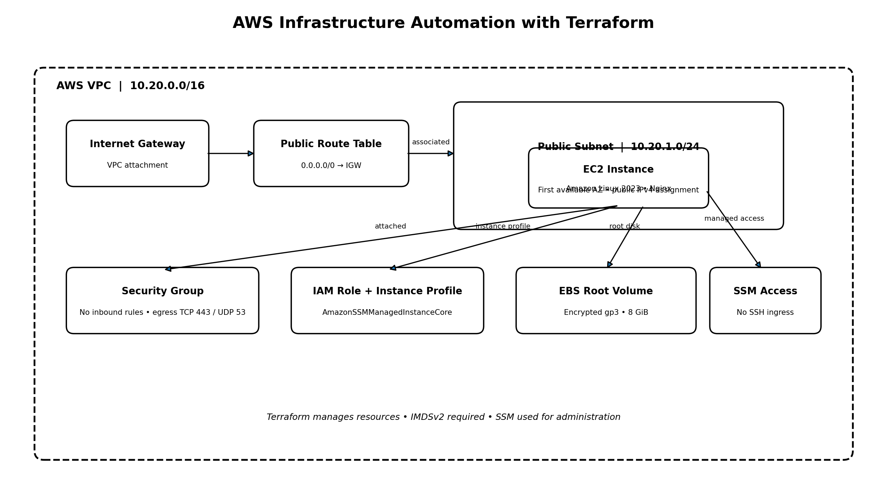

# AWS Infrastructure Automation with Terraform

A hands-on Infrastructure as Code (IaC) portfolio project that provisions a small AWS environment using Terraform.

> **Portfolio transparency:** This repository is a learning/demo implementation. Add your own deployment screenshots, decisions, and troubleshooting notes after running it. Do not describe it as production experience unless it was actually used in production.

## Architecture diagram



The diagram shows the VPC, public subnet, Internet Gateway, route table, EC2 instance, security group, IAM instance profile, EBS volume, and Systems Manager access path.

## What this project creates

- One VPC with DNS support and hostnames enabled
- One public subnet in the first available Availability Zone
- One Internet Gateway and public route table
- One EC2 instance running Amazon Linux 2023 and Nginx
- One security group with **no inbound rules**
- An EC2 IAM role and instance profile for AWS Systems Manager (SSM)
- Encrypted gp3 root storage and IMDSv2 token enforcement

Connect to the EC2 instance through **AWS Systems Manager Session Manager**. SSH (port 22) is not exposed.

## Repository structure

```text
aws-terraform-infrastructure/
├── images/
│   └── aws-terraform-architecture.png
├── terraform/
│   ├── versions.tf
│   ├── variables.tf
│   ├── main.tf
│   ├── outputs.tf
│   └── terraform.tfvars.example
├── .gitignore
└── README.md
```

## Prerequisites

- An AWS account
- AWS CLI configured with an identity allowed to create the resources in this project
- Terraform CLI >= 1.5
- An AWS region with available EC2 capacity
- Permission to use Systems Manager

Never commit AWS access keys, secret keys, Terraform state, or real `.tfvars` files.

## Deploy

Run these commands from the repository root:

```powershell
cd terraform
Copy-Item terraform.tfvars.example terraform.tfvars
# Edit terraform.tfvars if you want to change the region or names.

aws sts get-caller-identity
terraform init
terraform fmt -recursive
terraform validate
terraform plan -out=tfplan
```

Review the plan carefully before applying. Terraform will create billable AWS resources.

```powershell
terraform apply tfplan
```

## Connect to the instance

Install the AWS Systems Manager Session Manager plugin for your operating system if needed. Then run:

```powershell
terraform output instance_id
aws ssm start-session --target "$(terraform output -raw instance_id)" --region "$(terraform output -raw aws_region)"
```

The instance installs Nginx using user data. The security group intentionally has no inbound HTTP rule, so the `website_url` output is informational and will not be reachable from the public internet with the default security group. Verify Nginx locally from the SSM session:

```bash
curl -I http://localhost
```

## Destroy resources

When finished, destroy the environment to avoid ongoing charges:

```powershell
terraform destroy
```

Confirm the destroy plan before approving it.

## Security notes

- No SSH ingress is configured.
- EC2 uses an IAM instance profile with `AmazonSSMManagedInstanceCore`.
- IMDSv2 is required.
- The root EBS volume is encrypted.
- Egress is limited to HTTPS and DNS in this demo.
- The EC2 instance is placed in a public subnet and has a public IP; this is a learning setup, not a production reference architecture.
- For production, consider private subnets, VPC endpoints, tighter egress controls, centralized logging, remote Terraform state with locking, and least-privilege IAM policies.

## Interview discussion points

1. Why a VPC, subnet, Internet Gateway, and route table are needed.
2. How Terraform references create dependency ordering.
3. Why an EC2 instance profile is used instead of hard-coded credentials.
4. How Session Manager provides access without opening SSH.
5. How Terraform state works and why it must be protected.
6. What you would change to run workloads in private subnets.

## Next improvements

- Add private subnets and NAT/VPC endpoints
- Extract reusable VPC and EC2 Terraform modules
- Configure an S3 remote backend with state locking
- Add CI validation with GitHub Actions
- Add screenshots from your own deployment
